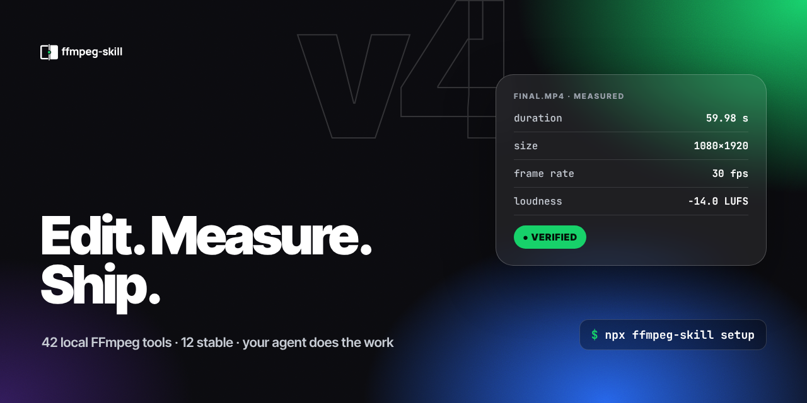
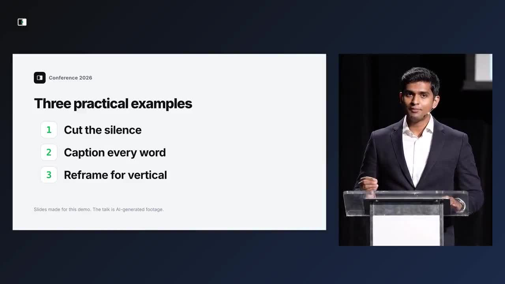
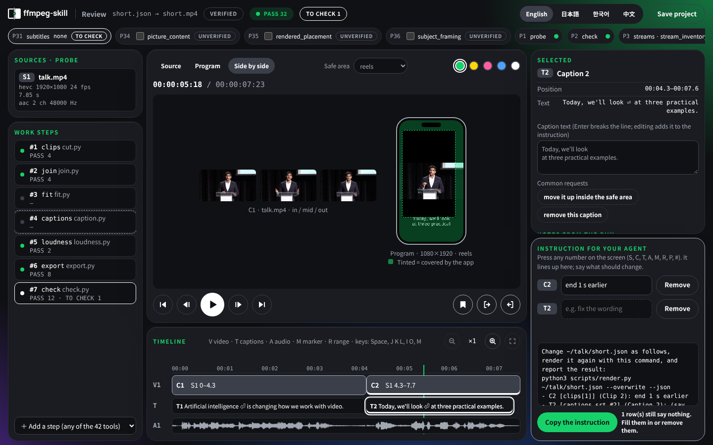

> **[中文化] ffmpeg-skill**
>
> 此项目是 [kajisho5/ffmpeg-skill](https://github.com/kajisho5/ffmpeg-skill) 的中文翻译版本。
> - 原项目 Stars: 10049
> - 主语言: Python
> - 许可证: MIT
> - 翻译日期: 2026-11-23
> - 原始 README: [README_en.md](README_en.md)
>
> 说明：下方 README 正文为**原项目文档的中文翻译**，力求忠于原文；本页顶部的「中文快速上手」为**面向中文用户的补充导读**（非原文内容），目的是让你不用读完整篇 README 就能先把项目跑起来。
>
> 如有翻译不准确之处，欢迎提 Issue 或 PR。

---


## 🚀 中文快速上手（补充导读，非原文）

### 这是什么 / 解决什么问题
`ffmpeg-skill` 是一个给编码 Agent（Claude Code、Cursor、Codex 或任何读取 `SKILL.md` 的 Agent）用的 Agent Skill，让 Agent 用本地 FFmpeg 来剪视频。它教 Agent 一套固定流程（probe → 尽量无损编辑 → 检查 → 验证），并附带 42 个基于 `ffmpeg` / `ffprobe` 的工具，覆盖剪切、拼接、去静音、适配时长与画幅、字幕与卡拉 OK、叠加与动态图形、HDR→SDR 与 LUT、音频清理、同步与漂移校正、多机位、响度、交付检查、整片项目渲染、批量处理等。它解决的是「让 Agent 真正动手剪片并自查输出」这件事，全程本地运行，不需要云服务或 API Key。

### 快速上手（最短路径）
1. 运行安装命令（README 顶部给出的命令）：
   ```bash
   npx ffmpeg-skill setup
   ```
2. 或直接运行（README 代码块给出的命令）：
   ```bash
   npx ffmpeg-skill
   ```
3. 在支持 Agent Skill 的客户端（Claude Code、Cursor、Codex 等）中让 Agent 读取 `SKILL.md`，按其中的工作流操作。原文未提供更细的客户端配置步骤，请参考下方 README 正文。
4. 编辑完成后，可让 Agent 展示 review page，或自行运行：
   ```bash
   npx ffmpeg-skill review project.json --result run.json
   ```
   （从代码检出运行时为 `python3 scripts/_review.py`。）

### 环境要求
- 操作系统：原文未说明具体支持哪些操作系统。
- 硬件：原文未说明硬件要求。
- 依赖：需要本地安装 `ffmpeg` / `ffprobe`；项目自述为「Python standard library」「no dependencies」，即 Python 侧不依赖第三方库。
- 版本要求：CI 中测试过 FFmpeg 6.1、7.1、8、9（见徽章与 package.json 描述）。
- 网络提示：安装通过 npm（`npx ffmpeg-skill`）分发，国内网络环境可能需要更换 npm 镜像源或加速下载。

### 常见坑与注意事项
- 必须本地有可用的 `ffmpeg` / `ffprobe`，否则工具无法实际执行；原文未说明是否会自动安装 FFmpeg。
- 项目定位是 Agent Skill，需要配合支持读取 `SKILL.md` 的 Agent 客户端使用，不是独立 GUI 工具。
- MCP 模式下默认只向客户端暴露核心 12 个工具以控制上下文体积，需要全部 42 个时设置环境变量 `FFMPEG_SKILL_MCP_FULL=1`。
- review page 为本地生成的单个 HTML 文件，不上传任何内容；原文未说明其他隐私或平台限制。

---


---

<p align="center">
  <picture>
    <source media="(prefers-color-scheme: dark)" srcset="brand/logo/ffmpeg-skill-horizontal-on-dark.svg">
    
  </picture>
</p>

<p align="center"><b>给你的编码智能体配一个视频编辑器。</b><br>
Claude Code、Cursor、Codex 或任何 MCP 客户端都能用本地 FFmpeg 剪辑你的素材，然后自行检查输出。<br>
无需云端 · 无需 API 密钥 · 仅用 Python 标准库</p>

<p align="center">
  <a href="https://kajisho5.github.io/ffmpeg-skill/"><b>网站</b></a> ·
  <a href="#quick-start"><b>快速开始</b></a> ·
  <a href="docs/demos.md">演示</a> ·
  <a href="#tools">工具</a> ·
  <a href="#mcp">MCP</a> ·
  <a href="https://www.npmjs.com/package/ffmpeg-skill">npm</a>
</p>

<p align="center">
  <a href="https://github.com/kajisho5/ffmpeg-skill/actions/workflows/ci.yml"></a>
  <a href="https://scorecard.dev/viewer/?uri=github.com/kajisho5/ffmpeg-skill"></a>
  <a href="https://www.npmjs.com/package/ffmpeg-skill"></a>
  <a href="https://www.npmjs.com/package/ffmpeg-skill"></a>
  <a href="#ffmpeg-compatibility"></a>
  <a href="LICENSE"></a>
  <a href="https://github.com/sponsors/kajisho5"></a>
</p>

<p align="center">
  <a href="https://kajisho5.github.io/ffmpeg-skill/"></a>
</p>

<p align="center">
  <a href="#quick-start"></a>
  &nbsp;
  <a href="https://kajisho5.github.io/ffmpeg-skill/#showcase"></a>
</p>

<p align="center">
  <a href="https://trendshift.io/repositories/211415"></a>
  &nbsp;
  <a href="https://www.star-history.com/kajisho5/ffmpeg-skill"></a>
</p>

<p align="center"><b>English</b> · <a href="https://kajisho5.github.io/ffmpeg-skill/?lang=ja">日本語（サイト）</a></p>

```bash
npx ffmpeg-skill
```

<table>
  <tr>
    <td width="50%"><br><sub><code>caption.py --animate pop --karaoke</code></sub></td>
    <td width="50%"><br><sub><code>fit.py --aspect 9:16 --fit crop</code></sub></td>
  </tr>
  <tr>
    <td width="50%"><br><sub><code>silence.py --threshold -35</code></sub></td>
    <td width="50%"><br><sub><code>loudness.py -I -14 --tp -1</code></sub></td>
  </tr>
</table>

<p align="center">
  <a href="https://kajisho5.github.io/ffmpeg-skill/#showcase"></a><br>
  <sub>十二段片段，全部通过对话剪辑：调色、慢动作与重新构图、把演讲与其幻灯片并排布局并剪成带字幕的短视频、去除停顿、绿幕合成、地平线校正，以及三段手机素材（防抖、提亮并降噪的夜景、60 fps 慢放）。<a href="https://kajisho5.github.io/ffmpeg-skill/#showcase">观看</a>（英文与日文）· <a href="docs/showcase.md">请求原文与确切命令</a>。九段由 Google Veo 生成；三段由手机拍摄。</sub>
</p>

### 审阅页面

剪辑完成后，向智能体索要审阅页面（"show me the review page"），或自行运行 `npx ffmpeg-skill review project.json --result run.json`（在仓库检出中运行 `python3 scripts/_review.py`）。它会写出一个本地 HTML 文件，展示素材来源、每一步及其检查、带平台安全区的手机框中的结果，以及时间线。按片段或字幕的编号，写下需要修改的内容，再把生成的指令复制回智能体。不上传任何内容；页面支持英文、日文、韩文和中文。

<p align="center">
  <a href="https://kajisho5.github.io/ffmpeg-skill/#review"></a><br>
  <sub>上述演讲的竖屏短视频，在审阅页面中（AI 生成素材）。</sub>
</p>

左半部分是输入，右半部分是命令产出的结果。**[每个前后对比演示，附确切命令 →](docs/demos.md)** —— 全部由 `python3 demos/build.py` 构建，你可以自行重建每一帧。图片来自 [demos/footage/](demos/footage/README.md)：由 Google Veo 生成的片段（人物与场景均不存在）以及少量手机拍摄素材。声音为合成音，少数演示（HDR10、全景图）使用合成画面。

`ffmpeg-skill` 是一个 [Agent Skill](https://docs.anthropic.com/en/docs/agents-and-tools/agent-skills)，适用于 Claude Code、Cursor、Codex 以及任何读取 `SKILL.md` 的智能体。它教给智能体一套固定工作流（探测 → 尽可能无损剪辑 → 检查 → 验证），并附带 **42 个工具**，用 `ffmpeg` / `ffprobe` 完成实际工作：剪切、拼接、去除静音、适配时长与宽高比、字幕与卡拉 OK、叠加与动态图形、HDR → SDR 与 LUT、音频清理与类型化动态处理、带漂移校正的同步、多机位、响度、交付检查、整片项目渲染、批量文件夹。每个工具也可作为 MCP 工具调用（`tools/list` 默认只公布核心 12 个以节省客户端上下文，设置 `FFMPEG_SKILL_MCP_FULL=1` 则列出全部 42 个；无论哪种方式，每个工具都可通过 `tools/call` 按名称调用），整套工具由一份机器可读的契约描述。

只要 `ffmpeg` 和 `python3` 在 PATH 上，它就能工作：离线运行，处理你不愿上传的素材。

- **保护你的源文件。** 与声明的输入相同的目标路径会被拒绝。直接编辑需要 `--overwrite` 才能替换已有输出。`batch --watch` 任务可以替换它在早前一轮交付过的未变更文件。试运行命令中的 `-y` 只有在工具检查目标之后才生效。
- **调用类型化工具。** 智能体提供具名选项，如 `--aspect 9:16` 和 `--fit pad`。工具负责构建 FFmpeg 命令和滤镜图。
- **验证剪辑结果。** 工具会探测源文件和写出的文件，因此智能体可以在报告成功之前检查实际时长、帧尺寸和音频。

> **SPEC**（Self-Producing Execution Contract，自生成执行契约）：每个工具的 `input_schema` —— 其契约和 MCP 工具定义中必须与 CLI 逐标志保持一致的部分 —— 从不与代码并排手写。它在运行时从已经定义 CLI 的同一个 `argparse` 解析器派生，任何漂移都会让 CI 构建失败。
> → [完整说明](#what-is-spec)

---

## 独立使用，也融入生态

**独立使用时**，这是一个本地 FFmpeg 引擎：探测 → 剪辑 → 验证，只需 `npx ffmpeg-skill`，别无他物。无需 API 密钥、无需账号、无需其他仓库。本节上下描述的都是这个独立工具，即使你从不读本节其余内容，这些描述也不会改变。

**在 [kajisho5](https://github.com/kajisho5) 更广泛的视频制作生态中**，本仓库是*双手*：它剪切、测量并导出文件，并以结构化 JSON 回报。它不决定剪什么、交付物是否可批准、什么让精彩片段有趣，或字幕该说什么（用户的提示文本按原样烧录，绝不改写以适配）—— 那些是*大脑*的工作，位于本引擎之前，而非之内。

| 你想要…… | 使用 |
|---|---|
| 立刻剪切 / 拼接 / 测量 / 导出文件 | **本仓库**（`ffmpeg-skill`），独立使用 |
| 决定剪切点、批准交付物、规划整片剪辑 | [`video-production-agent`](https://github.com/kajisho5/video-production-agent) / [`AI-video-production-OS`](https://github.com/kajisho5/AI-video-production-OS) |
| 跨工作区构建类型化剪辑图，无需手写原始 `ffmpeg` | [`video-editing-skill`](https://github.com/kajisho5/video-editing-skill) / [`audio-production-skill`](https://github.com/kajisho5/audio-production-skill) |
| 在真实录制上叠加 Remotion 动态图形（动画字幕、静音跳切、音频峰值动效） | [`remotion-ffmpeg-skill`](https://github.com/kajisho5/remotion-ffmpeg-skill)：其合成从本仓库的 `probe.py`、`silence.py` 和 `scenes.py` 获取时长、fps、帧、静音、场景切换、音频峰值和节拍。它用 `check.py` 和 `look.py` 验证渲染，用 `overlay.py`（`--place` 用于其 `--sparse` 模式）合成图形层，并通过 `render.py --template` 交付 |

生态中的其他仓库 —— [`media-analysis-skill`](https://github.com/kajisho5/media-analysis-skill)、[`transcription-skill`](https://github.com/kajisho5/transcription-skill)、[`subtitle-skill`](https://github.com/kajisho5/subtitle-skill)、[`thumbnail-skill`](https://github.com/kajisho5/thumbnail-skill)、[`color-grading-skill`](https://github.com/kajisho5/color-grading-skill)、[`motion-graphics-skill`](https://github.com/kajisho5/motion-graphics-skill)、[`qc-skill`](https://github.com/kajisho5/qc-skill) —— 像任何智能体框架一样读取本仓库的 `contract --json`、各工具的 `--json` 输出和 `doctor`；本仓库不调用它们中的任何一个。依赖是单向的。

---

**目录**
[独立使用，也融入生态](#standalone-and-in-an-ecosystem) · [为什么](#why) · [快速开始](#quick-start) · [工作原理](#how-it-works) · [设计原则](#design-principles) · [工具](#tools) · [音频](#audio-is-a-first-class-input) · [为智能体而建](#built-for-agents) · [FAQ](#faq) · [FFmpeg 兼容性](#ffmpeg-compatibility) · [真实素材测试](#tested-on-real-footage) · [安装](#install) · [要求](#requirements) · [开发](#development) · [文档](#docs)

---

## 为什么

一个"懂 FFmpeg"的智能体仍然靠猜：它假设帧率、选一个容器装不下的编解码器、对只需流复制的文件重新编码，并在不打开结果的情况下报告"完成"。本技能消除猜测：

- **真实文件优先。** 每个任务都从 `probe.py` 开始；智能体根据测得的时长、fps、分辨率、色彩和音频布局做决定，而不是根据文件名。
- **结构化工具，而非 shell 字符串。** 每个操作都是一个带类型化参数的脚本。不经过 shell；不接受调用方提供的滤镜图。
- **智能体可读的契约。** `contract --json` 为每个工具说明：它接受什么、写出什么、需要哪些 FFmpeg 组件、结果如何验证。MCP 接口由它派生。
- **执行后验证。** 结果会被探测、对照目标规格检查，画面有变化时还会以联系表形式查看。
- **本地优先。** 无云端、无 API 密钥、无 Python 依赖。可选的本地转写仅在安装了语音引擎（Parakeet 或 whisper）时使用，从不强制 —— 由 `caption.py --transcribe` 使用，自 1.17 起也由 `silence.py --transcribe` 使用（配合 `--filler`，或自 3.6 起配合 `--sentence-min-silence` / `--sentence-margin-tail`）；两者也接受你已有的转写稿，两者在缺少引擎时都会给出安装命令而非猜测。两者都接受 `--engine` 和 `--model`；`FFMPEG_SKILL_ASR_ENGINE` 和 `FFMPEG_SKILL_ASR_MODEL` 设置本机默认值（例如在安装了该 whisper.cpp 模型的机器上用 `large-v3-turbo`；两者都不设时，自动和 `base`）。引擎在本机运行，音频从不上传；parakeet-mlx、faster-whisper 和 openai-whisper 首次运行时下载模型权重（parakeet-mlx 默认从 Hugging Face 下载）。

## 论文

本技能背后的设计纪律 —— 面向 AI 智能体的逐操作验证 —— 已写成一篇立场论文。论文将 ffmpeg-skill 本身评为仅部分符合它所定义的纪律。

Kajiyama, S. (2026). *What Is Verification-Driven Coding? — A Discipline for Not Trusting Generation.* Zenodo. https://doi.org/10.5281/zenodo.23720216

## 快速开始

一条命令完成下面第 0 到 2 步：`npx ffmpeg-skill setup` 为机器上找到的每个智能体安装技能（`~/.claude`、`~/.cursor`、`~/.codex` 或 `~/.agents`；一个都没找到时安装到 Claude Code），在 `ffmpeg` 无法运行时安装 FFmpeg（`brew install ffmpeg-full`、`winget install --id Gyan.FFmpeg -e` 或 `sudo apt-get install -y ffmpeg`，运行前会打印出来；`--no-ffmpeg` 从不运行包管理器），最后运行 `doctor` 并返回其退出状态。在没有这三种包管理器的系统上，它会安装技能、提示 FFmpeg 仍缺失，并以非零状态退出。它需要 Node 16+ 和 Python 3.10+，但两者都不安装。

```bash
npx ffmpeg-skill setup
```

分步执行同样的步骤：

```bash
# 0. FFmpeg 本身，一次即可（此处以 Ubuntu/Debian 为例；macOS 和
```