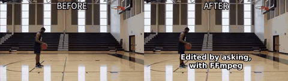
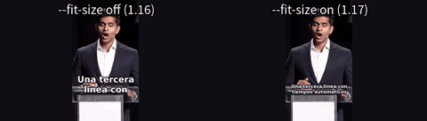
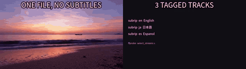
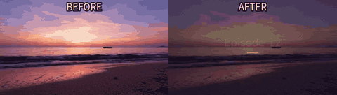
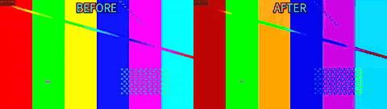
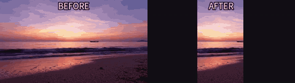
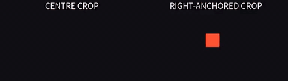
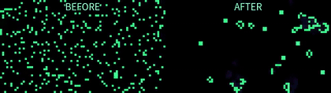
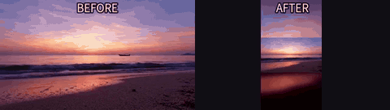

# 演示画廊

要完整剪辑口播素材，请参阅[带字幕的 Reels 操作指南](../examples/reels-walkthrough.md)。

本页图片来自 `demos/footage/`：用 Google Veo 生成的 AI 片段（其中的人物和地点并不存在），以及少量手机拍摄的片段。声音是合成的，因此每个演示测得的停顿和电平都是构建产物的事实；少数演示（HDR10、全景图、帧序列）也使用合成画面。`reframe_talk`、`filler_en` 和 `pauses_en` 使用 AI 生成的语音。每个"之后"都是在本仓库的脚本上对源文件运行得到的。重建整页素材：

```bash
python3 demos/build.py            # 或：npm run demo
python3 demos/build.py --list     # 查看会构建哪些内容
python3 demos/build.py --only captions_ja
```

全分辨率的 `<name>_before.mp4`、`<name>_after.mp4` 和并排对比的 `<name>.mp4` 会输出到 `demos/out/`（已被 gitignore）。只有下方的小预览图会被提交，且任一预览图超过 500 KB 时构建会失败。

每个预览中，左半部分是输入，右半部分是命令的输出——除非烧录标签另有说明，用于对比两种设置的演示（无损剪切对比精确剪切），而非"之前"对比"之后"。

底部的工具位于 **Inspection** 下，没有画面：它们回答问题而非改变画面，因此命令本身就是演示。


## 字幕与文本

### 烧录字幕（英文）



```bash
python3 scripts/caption.py demos/out/fixtures/motion.mp4 --text demos/out/fixtures/cues_en.txt --size 30 --bold --position bottom --margin 40 -o demos/out/captions_en_after.mp4
```

**看点：** 纯文本提示会转成 SRT 并由 libass 渲染——描边和边距来自参数，而非模板。

### 短语感知换行


```bash
python3 scripts/caption.py demos/out/fixtures/motion.mp4 --text demos/out/fixtures/cues_phrase.txt --size 34 --bold --position bottom --margin 40 --wrap measured --preset veryfast -o demos/out/captions_phrase_before.mp4
python3 scripts/caption.py demos/out/fixtures/motion.mp4 --text demos/out/fixtures/cues_phrase.txt --size 34 --bold --position bottom --margin 40 --wrap phrase --preset veryfast -o demos/out/captions_phrase_after.mp4
```

**看点：** 同一提示、同一字号，只差一个参数。左侧是 1.15 的换行，只最小化最宽行，把 `the` 和 `con` 孤零零留在行尾；右侧是 1.16 的默认行为，从不在单词内断行，也从不以冠词或介词结尾。文本本身未动——该技能从不改写字幕来适配。

### 字幕字号适配提示



```bash
python3 scripts/caption.py demos/out/fixtures/vertical.mp4 --text demos/out/fixtures/cues_phrase.txt --platform tiktok --max-lines 2 --fit-size off --bold --preset veryfast -o demos/out/captions_fitsize_before.mp4
python3 scripts/caption.py demos/out/fixtures/vertical.mp4 --text demos/out/fixtures/cues_phrase.txt --platform tiktok --max-lines 2 --fit-size on --bold --preset veryfast -o demos/out/captions_fitsize_after.mp4
```

**看点：** 同一提示文件、同一目标平台，只差一个参数。左侧是 1.16：在 TikTok 字幕字号下提示无法排成两行，于是被拆成两条连续提示，半句话迟到。右侧是 1.17 的默认行为：字号降低到整句同时出现在屏幕上，且远高于画面高度 4.5% 的下限。文本未动——该技能从不改写字幕来适配。

### 一个文件中的三条字幕轨



```bash
python3 scripts/caption.py demos/out/fixtures/mandel.mp4 --mode mux --srt demos/out/captions_multitrack_track_en.srt:en --srt demos/out/captions_multitrack_track_ja.srt:ja --srt demos/out/captions_multitrack_track_es.srt:es --default-track en -o demos/out/captions_multitrack_muxed.mkv
```

**看点：** 没有烧录，也没有重编码：视频和音频逐比特复制，三条 SRT 作为可切换、带语言标记的流随行。右半部分是 ffprobe 读回的轨道列表。

### 日文字幕


```bash
python3 scripts/caption.py demos/out/fixtures/motion.mp4 --text demos/out/fixtures/cues_ja.txt --size 30 --bold --position bottom --margin 40 -o demos/out/captions_ja_after.mp4
```

**看点：** 字体按文字系统选择：日文提示自动获得 CJK 字体，因此不会出现方框豆腐块。

### 中文字幕


```bash
python3 scripts/caption.py demos/out/fixtures/motion.mp4 --text demos/out/fixtures/cues_zh.txt --size 30 --bold --position bottom --margin 40 -o demos/out/captions_zh_after.mp4
```

**看点：** 同一命令，汉字文本：换行和字体切换无需 --font 参数即可处理。

### 韩文字幕


```bash
python3 scripts/caption.py demos/out/fixtures/motion.mp4 --text demos/out/fixtures/cues_ko.txt --size 30 --bold --position bottom --margin 40 -o demos/out/captions_ko_after.mp4
```

**看点：** 即使同一提示中混入拉丁词，谚文仍能赢得文字系统检测。

### 阿拉伯语字幕


```bash
python3 scripts/caption.py demos/out/fixtures/motion.mp4 --text demos/out/fixtures/cues_ar.txt --size 30 --bold --position bottom --margin 40 -o demos/out/captions_ar_after.mp4
```

**看点：** 由 libass 塑形的从右到左文本；其中的拉丁片段保持从左到右。

### 带动画弹出和卡拉 OK 的字幕


```bash
python3 scripts/caption.py demos/out/fixtures/motion.mp4 --text demos/out/fixtures/cues_pop.txt --size 30 --bold --position bottom --margin 40 --animate pop --karaoke --highlight-color '#39ff88' -o demos/out/captions_pop_karaoke_after.mp4
```

**看点：** 每条提示缩放进入，高亮颜色逐词扫过整行。

### 彩色 Emoji 字幕


```bash
python3 scripts/caption.py demos/out/fixtures/motion.mp4 --text demos/out/fixtures/cues_emoji.txt --size 30 --bold --margin 40 --emoji mono -o demos/out/captions_emoji_before.mp4
python3 scripts/caption.py demos/out/fixtures/motion.mp4 --text demos/out/fixtures/cues_emoji.txt --size 30 --bold --margin 40 --emoji-assets demos/out/fixtures/emoji -o demos/out/captions_emoji_after.mp4
```

**看点：** 左侧：此 ffmpeg 的 libass 绘制的 emoji（单色或缺失）。右侧：每个 emoji 簇一张 PNG 合成到字幕上，ASS 预留精确间隙——文本不移动。

### 塑形后的印地语下三分之一


```bash
python3 scripts/graphics.py demos/out/fixtures/motion.mp4 --template lower-third --name 'प्रिया शर्मा' --title 'निर्देशक' --start 0.5 --end 5 --text-render ass -o demos/out/lower_third_hindi_after.mp4
```

**看点：** 左侧：同一文本经 drawtext——i-matra 未重排，末尾 matra 被丢弃。右侧：graphics.py 自动将天城文路由到 libass。drawtext 在任何构建上都不使用 harfbuzz。

### 下三分之一


```bash
python3 scripts/graphics.py demos/out/fixtures/motion.mp4 --template lower-third --name 'Ada Lovelace' --title 'Analytical Engine' --start 0.5 --end 5 -o demos/out/lower_third_after.mp4
```

**看点：** 姓名和头衔从画面左侧滑入再滑出——不涉及图片素材。

### 标题卡



```bash
python3 scripts/graphics.py demos/out/fixtures/mandel.mp4 --template title --title 'Episode 12' --subtitle 'The math of video' --start 0 --end 4 -o demos/out/title_card_after.mp4
```

**看点：** 居中的标题和副标题在开头几秒淡入，片段其余部分不受影响。


## 画面

### 带淡入淡出的 Logo 叠加


```bash
python3 scripts/overlay.py demos/out/fixtures/motion.mp4 --image demos/out/fixtures/logo.png --position top-right --scale 200 --opacity 0.9 --start 0.5 --end 7.5 --fade 0.6 -o demos/out/logo_overlay_after.mp4
```

**看点：** 半透明 Logo 在 0.5 秒淡入，结束前淡出；底层画面不变。

### HDR10 转 SDR



```bash
python3 scripts/color.py demos/out/fixtures/hdr10.mp4 --to-sdr --tonemap hable --preset veryfast -o demos/out/hdr_tonemap_after.mp4
```

**看点：** PQ / BT.2020 源被色调映射到 BT.709：在 SDR 屏幕上，"之前"是发白的那一侧。

### 通过裁剪实现 16:9 转 9:16



```bash
python3 scripts/fit.py demos/out/fixtures/mandel.mp4 --aspect 9:16 --fit crop --width 540 --preset veryfast -o demos/out/reframe_crop_after.mp4
```

**看点：** 竖幅从宽幅中心切出——全高保留，两侧丢失。

### 检查竖幅裁剪是否丢失运动



```bash
python3 scripts/fit.py demos/out/fit_crop_check_offcentre.mp4 --aspect 9:16 --fit crop --preset veryfast --json -o demos/out/fit_crop_check_centre.mp4
python3 scripts/fit.py demos/out/fit_crop_check_offcentre.mp4 --aspect 9:16 --fit crop --preset veryfast --json --crop-x 1 -o demos/out/fit_crop_check_after.mp4
```

**看点：** 中心裁剪报告 crop_content_off_centre 并建议右移。使用 --crop-x 1 的裁剪保留了运动块并报告 crop_check.verdict: ok。

### 将口播人物转为竖幅（AI 生成素材）


```bash
python3 scripts/fit.py demos/footage/ai_talk.mp4 --aspect 9:16 --fit crop --crop-x 0.27 --width 540 --preset veryfast -o demos/out/reframe_talk_after.mp4
```

**看点：** 9:16 画幅用 --crop-x 0.27 对准说话者，而非中心——中心会把她的脸切成两半。源是 AI 生成素材，不是真人。

### 通过填充实现 16:9 转 9:16


```bash
python3 scripts/fit.py demos/out/fixtures/mandel.mp4 --aspect 9:16 --fit pad --pad-fill blur --width 540 --preset veryfast -o demos/out/reframe_pad_after.mp4
```

**看点：** 什么都不丢：宽幅完整保留，上下空隙用模糊副本填充。

### 变速以匹配时长


```bash
python3 scripts/fit.py demos/out/fixtures/motion.mp4 --duration 4 --method speed --preset veryfast --json -o demos/out/speed_up_after.mp4
```

**看点：** 8 秒片段重新定时为 4 秒，音频音高校正。JSON 结果报告 large_speed_change，倍数为 2。

### 倒放



```bash
python3 scripts/reverse.py demos/out/fixtures/life.mp4 --preset veryfast -o demos/out/reverse_after.mp4
```

**看点：** 生命游戏图案倒放——细胞"复活"；音频随之倒放。

### 交叉淡化拼接


```bash
python3 scripts/join.py demos/out/fixtures/motion.mp4 demos/out/fixtures/mandel.mp4 --transition fade --duration 0.8 --width 960 --preset veryfast -o demos/out/join_fade_after.mp4
```

**看点：** 两段不同内容的片段合为一体；注意中间 0.8 秒的溶解。

### 经黑场拼接


```bash
python3 scripts/join.py demos/out/fixtures/motion.mp4 demos/out/fixtures/mandel.mp4 --transition fadeblack --duration 0.8 --width 960 --preset veryfast -o demos/out/join_fadeblack_after.mp4
```

**看点：** 同样的拼接但用 fadeblack：切换处沉入黑场，而非混合两幅画面。

### 16:9 转 9:16 配模糊背景



```bash
python3 scripts/fit.py demos/out/fixtures/mandel.mp4 --aspect 9:16 --fit blur --width 540 --preset veryfast -o demos/out/fit_blur_after.mp4
```

**看点：** 不裁剪也没有黑边：整个宽幅居中放在自身模糊、变暗的副本上。

### 无损剪切对比精确剪切


```bash
python3 scripts/cut.py demos/out/fixtures/mandel.mp4 --start 2.05 --duration 3 --tolerance 5 --json -o demos/out/cut_accurate_before.mp4
python3 scripts/cut.py demos/out/fixtures/mandel.mp4 --start 2.05 --duration 3 --accurate --preset veryfast -o demos/out/cut_accurate_after.mp4
python3 scripts/look.py demos/out/fixtures/mandel.mp4 --at 2.05 --compare demos/out/cut_accurate_after.mp4 --compare-at 0 -o demos/out/cut_accurate_start.png
```

**看点：** 两侧都要求从 2.05 秒开始。流复制只能对齐到最近的关键帧，因此其首帧来自片段更早处；--accurate 重编码并从要求的帧开始。

### 剪掉一段，保留其余


```bash
python3 scripts/cut.py demos/out/fixtures/mandel.mp4 --remove 2-4 --accurate --preset veryfast --json -o demos/out/cut_remove_after.mp4
```

**看点：** cut.py --remove 2-4 从中间去掉两秒并拼接剩余部分："之后"一侧从源的 2 秒跳到 4 秒，提前两秒结束。

### 帧精确剪切，仅重编码两端


```bash
python3 scripts/cut.py demos/out/cut_smart_gop30.mp4 --start 1.3 --end 6.6 --smart --json -o demos/out/cut_smart_after.mp4
```

**看点